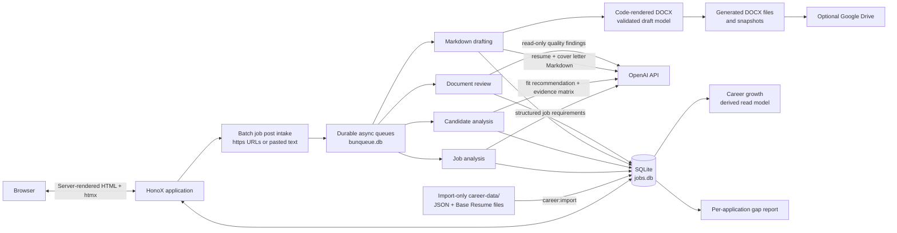

# Job Application Tracker

A local-first, server-rendered job pipeline built with Bun, HonoX, htmx, Drizzle ORM, SQLite, Tailwind CSS, and daisyUI. It has no client-side React or Preact hydration runtime.

## Data flow



The application persists each requested operation as an append-only run in SQLite before queuing it. In production, the named queues use embedded Bunqueue and durable state in `QUEUE_FILE_NAME` (normally `/data/bunqueue.db`); at startup the application recovers queued runs. In development, the same jobs run in-process without Bunqueue persistence. The browser never waits for a model response: it polls the persisted run state through htmx. Document generation drafts Markdown from an approved Base Resume plus complete canonical Career Data (and a reviewed JD when present), validates it deterministically, and renders DOCX in code; a generated document is a draft, not an approved application artifact.


## Career data setup

SQLite is the runtime authority for career facts, directions, categories, personal skills and Base Resume versions. Manage them in the app under **Career Data**; a fresh database shows an onboarding notice and asks for your identity first, and no page requires a `career-data/` directory.

The repository still ships `career-data.example/`: a small, valid, import-only dataset that lets a fresh clone seed a database and run tests. Import it (or your own private directory) explicitly — dry-run first, then `--apply`:

```sh
cp -R career-data.example career-data          # your private copy, ignored by Git
bun run career:import --source career-data --database ./jobs.db                 # dry run (default)
bun run career:import --source career-data --database ./jobs.db --apply         # write in one transaction
```

Every CLI that reads or writes the database requires an explicit target: pass `--database <path>` or set `DB_FILE_NAME`. Without one it fails before opening anything, because importing the database client would otherwise open the default `./jobs.db`.

`career:import` accepts a legacy `career-data/` directory (the JSON files plus `skill-taxonomy.json` and optional `base-resumes/`) or an exported `career-dataset` JSON file. It merges by stable key, never deletes records missing from the source, reports conflicts instead of guessing, and binds the source hash and database revision so a stale preview is rejected. Keep stable IDs when editing imported files; directions and target titles come from `preferences.json` `directionDefinitions` on import and are then edited in the UI.

Career Data can also live in a separate private repository. `CAREER_DATA_DIR` is an **import-only** input read by the import/legacy-sync CLIs; the running app never reads it. Set it in the ignored local `.env` (leave `.env.example` portable):

```ini
CAREER_DATA_DIR=../career-profile-private
```

The private repository root should contain the same JSON files and `base-resumes/` directory that would otherwise live under `career-data/`. Keeping source code and personal career facts separate lets this application remain reusable without duplicating private data.

### Approved Base Resumes

An approved Base Resume is private Markdown that serves as an editorial starting point for drafting, while the database career facts remain the factual authority. Versions live in the `career_base_resumes` table with their direction, version label, approval date and normalized-text SHA-256 hash. Create, preview and approve them under **Career Data → Base Resumes**; superseded and draft versions are kept so historical documents stay reproducible. Missing an approved Base Resume disables document generation only for that direction — the app never falls back to a blank resume.

The `resume:import` CLI is an import-only helper for a PDF, Markdown or text file. It stages normalized Markdown plus a `manifest.json` under `career-data/base-resumes/` (PDF extraction uses Ghostscript locally; production never extracts PDFs), then `career:import` loads it into SQLite:

```sh
bun run resume:import -- --direction fhir --input ~/resumes/fhir.pdf --version v1 --database ./jobs.db
bun run career:import --source career-data --database ./jobs.db --apply
```

### ChatGPT career context

Export one versioned JSON ChatGPT context per direction from the database (no ChatGPT network call is made):

```sh
# Export every direction with an approved Base Resume to ./chatgpt-context
bun run career:export-chatgpt-context -- --database ./jobs.db

# Export only selected directions
bun run career:export-chatgpt-context -- --database ./jobs.db --direction fullstack
bun run career:export-chatgpt-context -- --database ./jobs.db --direction frontend --direction fhir
```

Each file combines the direction's approved Base Resume with safe database career facts, the effective generation rules and an evidence index. Publication source URLs and project URLs are excluded by default; pass `--include-source-urls` only when you deliberately want them. Regenerate after changing career facts or approving a new Base Resume. When asking ChatGPT to tailor a resume, attach or reference the direction file from `chatgpt-context/` together with the job description.

## Run locally

```sh
bun install
bun run setup     # applies the schema migrations
bun run dev
```

`bun run setup` is `bun run db:migrate` and nothing else: boot never synchronizes private career data. `bun run db:migrate` is also safe to run on its own.

The SQLite database is created as `jobs.db`. Set `DB_FILE_NAME` to use a different file.

## Career skill taxonomy and sync (import-only, retired at boot)

`skill_categories` and `skills` in SQLite are the runtime authority. Manage categories as **Skills settings** and personal skills under **Career Data**, or import them transactionally with `career:import`.

The legacy per-file sync CLIs below are kept for explicit one-off imports from a JSON `career-data/` directory. `setup` and `start` never run them, and they are not the supported path for a full migration:

```sh
bun run skills:audit --database ./jobs.db        # read-only review of duplicates, aliases, and non-skills
bun run taxonomy:sync --database ./jobs.db       # dry-run; import-only legacy taxonomy sync
bun run taxonomy:sync --database ./jobs.db --apply # upsert JSON-owned key, label, and sort order
bun run skills:sync --database ./jobs.db         # dry-run preview (default)
bun run skills:sync --database ./jobs.db --apply # write inside a transaction
bun run skills:sync --database ./jobs.db --check # non-zero exit when conflicts require manual review
```

- Every command above also accepts `DB_FILE_NAME` instead of `--database`, and fails without an explicit database.

- Each imported career skill uses a stable lowercase kebab-case `id`, declares a `category` from the adjacent `skill-taxonomy.json`, and may list aliases. That ID becomes the immutable `skills.key`; labels and aliases are never used to guess identity.
- Taxonomy import is idempotent. It upserts configured keys, labels, and sort order; categories no longer present in JSON are retained as orphaned database rows so historical skill records are not invalidated.
- Sync matches only the immutable key to `skills.key`. It updates an exact-key row or creates a new approved skill; labels and aliases never cause an automatic merge.
- Evidence, levels, last-used dates, review notes, and directions are never copied into the taxonomy tables.
- `bun run skills:sync --database ./jobs.db --if-present` exits cleanly when no `career-data/` is mounted; nothing calls it on boot any more.

## Career data and document generation

Database career records are the canonical, factual source used to generate documents. Stable keys survive rename: a direction references the underlying experience, achievement, project, or skill records by key, and editing them in the UI bumps the career revision so dependent documents become visibly stale.

- Identity, education, experiences, achievements, projects, publications, stories, personal skills, directions and preferences are edited under **Career Data**. Publications keep a display-ready citation and structured authors, including an `isCandidate` marker.
- Directions carry their `label` and `targetTitles`; bounded generation rules are edited per direction.
- Legacy `career-data/` JSON is an import source only. Every original field, including authored extension fields, is preserved in the database and remains editable in the UI.

Every generation run records an immutable evidence-selection snapshot in the database and writes a matching JSON file beneath `ARTIFACTS_DIR/run-<id>/`. The workspace’s **Evidence selection & generation record** section shows the exact selected IDs and schema/prompt versions, and lets you download that snapshot. This makes a generated resume or letter reviewable even after career data changes.

Do not use the removed `CANDIDATE_PROFILE_FILE` or `CANDIDATE_PROFILE_JSON` configuration; candidate facts come only from the database.

For Fly.io deployment, `fly.toml` mounts a persistent volume at `/data` and sets `DB_FILE_NAME=/data/jobs.db`. The machine is configured to stay running (`auto_stop_machines = 'off'`, `min_machines_running = 1`). Create the volume once before deploying:

```sh
fly volumes create data --region yyz --size 1
fly deploy
```

Set `ARTIFACTS_DIR=/data/artifacts` and `QUEUE_FILE_NAME=/data/bunqueue.db` in Fly as well, so snapshots, generated documents, and queued work survive machine restarts.

The production start command runs Drizzle migrations before starting the server and does not touch career-data files. Keep one Fly machine for this SQLite deployment because Fly volumes are attached to a single machine. To move existing volume career files into SQLite, follow the **Fly career-data migration runbook** in `docs/migrations.md`; the legacy `bun run fly:sync-career-data` file upload is retired in favour of a consistent database backup plus `career:import`.

The `bun run fly:sync-career-data` file upload is a retired import-only helper. It uploads legacy `career-data/` JSON and Markdown to the mounted volume so they can be imported; it is no longer part of the runtime or the migration path. Runtime facts are not re-read from the volume. Use the runbook in `docs/migrations.md` for any real migration, and never overwrite a production `jobs.db` with local data.

## Base-grounded document generation

Documents are drafted from an **approved Base Resume** (editorial prior) plus **complete safe canonical Career Data** (factual authority), and a reviewed Job Description when generating for a specific application. The model writes Markdown using a controlled section vocabulary; a safe parser produces a typed document model, deterministic checks report omissions, dates, and unsupported claims, and code renders the DOCX. The renderer owns the title, contact line, and layout — the model never overwrites user-confirmed metadata.

- With a JD: a targeted resume and cover letter grounded in the reviewed JD, resolved Include/Skip decisions. The full safe career data is always supplied; direction selects the Base Resume and target titles only.
- Without a JD (baseline): a reusable direction baseline from the Base Resume and Career Data only. It never invents an employer or claims JD alignment.

Generation freshness covers the Base Resume, Career Data, JD, decisions, direction, prompt, model, and draft/render contract, so prior documents become visibly stale when their true inputs change.

## Batch job post intake

**Import jobs** (`/applications/import`) accepts one `https` URL or one pasted job description per box (multi-line is fine), preserving input order. URLs are validated before any fetch: `https` only, no credentials, no localhost/private/reserved addresses, bounded redirects/bytes/time, and scripts/styles are stripped. A blocked or failed link keeps its URL and becomes **Needs pasted text** — blank or error HTML is never sent to the model. Successful text is analyzed through the existing Job Analysis, and the created application appears in Review with placeholder metadata for you to confirm. First drafts are generated only for explicitly selected, Documents-ready applications.

## Gap report and Career growth

- **Gap report** (per application): the Review workspace shows each requirement's importance, source excerpt, evidence references, status (`direct`, `transferable`, or `unknown-evidence`), and Include/Skip controls. `unknown-evidence` means Career Data does not verify the requirement; it never claims you lack a skill.
- **Career growth** (`/career-growth`): a derived read model over active applications, grouped by canonical skill and ranked by application frequency, requirement importance, direction relevance, and retention. It uses neutral labels — *Verify existing evidence*, *Consider learning/project evidence*, and *Low priority* — and never writes a mutable table or modifies private Career Data.

## How to use the tracker

1. In **Applications**, paste a posting and use **Parse with AI**, or enter the known facts directly in Quick collect.
2. Review the draft. Add the job URL, source, company, and direction yourself, then save it as **Saved**.
3. Move a role to **Apply Today** when it becomes a task. Complete the application workspace and select **Sent application** after applying.
4. Record follow-ups and interviews in the workspace. These activities advance the visible pipeline without overwriting a more advanced status.
5. In **Review**, resolve every missing skill: **Skip**, or **Include** with a truthful, application-specific reason. This creates the evidence selection used for generation.
6. In **Documents**, explicitly generate the resume and cover letter. Review the reviewed Markdown draft, deterministic warnings, and DOCX files; optionally request a semantic document review. A generated file is a draft until you decide it is suitable to use.
7. Download approved documents or upload them to Google Drive when it is connected. Existing artifacts and Drive links remain available if a newer run later becomes outdated.
8. Manage reusable companies, contacts, and skills from their dedicated pages under Career and Network. Export JSON periodically as a backup.

### Configuration

Copy `.env.example` to `.env` for local development. `OPENAI_API_KEY` is needed only for AI parsing, analysis, and document generation. Google OAuth variables are needed only for optional Drive uploads. `CAREER_DATA_DIR` and `CAREER_BASE_RESUMES_DIR` are **optional import-only** inputs read by `career:import` and the retired per-file sync CLIs; the running app reads career facts, directions, categories, personal skills and Base Resume versions from SQLite and needs neither variable. Each specialized model variable (`OPENAI_MODEL_JOB_PARSER`, `OPENAI_MODEL_CANDIDATE_FIT`, `OPENAI_MODEL_RESUME`, `OPENAI_MODEL_COVER_LETTER`, `OPENAI_MODEL_DOCUMENT_REVIEW`) falls back to `OPENAI_MODEL_DEFAULT`.

### Private deployment authentication

Fly deployment is fail-closed because `fly.toml` sets `APP_AUTH_REQUIRED=true`. Before deploying, generate a password, display it once, save it in a password manager, and set both credentials as Fly secrets:

```sh
APP_AUTH_PASSWORD="$(openssl rand -base64 32)"
printf 'Job Tracker password: %s\n' "$APP_AUTH_PASSWORD"
fly secrets set --app job-hunting \
  APP_AUTH_USERNAME='fred' \
  APP_AUTH_PASSWORD="$APP_AUTH_PASSWORD"
unset APP_AUTH_PASSWORD
```

The browser presents its native Basic Auth prompt. Without both secrets, production returns `503` instead of exposing the application. Local development remains open while `APP_AUTH_REQUIRED=false`; set the username and password in the ignored `.env` file when local authentication testing is needed. Every application route also uses same-origin CSRF validation, security headers, and `Cache-Control: no-store`.

### GitHub Actions deployment

The workflow in `.github/workflows/ci-cd.yml` runs formatting, typechecking, tests, and a production build for pull requests and pushes to `main`. It does not deploy automatically. To deploy, open **Actions**, select **CI and Fly Deploy**, choose **Run workflow** from `main`, and run it after CI passes. Add a repository secret named `FLY_API_TOKEN` before the first manual deployment.

### VS Code Remote / WSL

The dev server listens on all interfaces at port `5173`. If `http://localhost:5173` is not reachable from your browser, open the VS Code **Ports** panel and forward port `5173`; VS Code will provide the correct localhost URL. You can also use the Network URL printed by Vite (for example, `http://172.17.x.x:5173/`).

## Skill review, scores, and generation readiness

- A parsed job post produces structured skill requirements, each with a canonical name, category, importance, source excerpt, and confidence.
- Requirements resolve against the SQLite catalog: exact keys and curated aliases resolve deterministically; unknown or ambiguous terms stay pending as requirement-owned mentions and never auto-create catalog records.
- The application workspace has a **Review** tab. Every `not-in-career-data` skill must be skipped or included with a reason before document generation is enabled.
- Dual scores are shown: **canonical match** (proven matches only) and **application coverage** (proven matches plus user-confirmed includes). Skipped and pending requirements count as uncovered.
- An include is application-only: it never changes career data or the canonical score, and its mandatory reason is the only allowed claim in generated documents.

## LLM workflow and boundaries

The pipeline makes five distinct model calls, each with a separate trust boundary. Every prompt, response schema, and frozen input records a version, and every run records the selected model in SQLite.

1. **Job-only analysis** (`OPENAI_MODEL_JOB_PARSER`) — receives only the raw job posting and a bounded approved catalog snapshot. It never sees a resume, career data, or candidate identity, and it never produces a fit score. It proposes a direction from the supplied direction definitions.
2. **Candidate fit / evidence matrix** (`OPENAI_MODEL_CANDIDATE_FIT`) — an explicit, queued paid action. It receives a frozen canonical input snapshot (career data and the reviewed job requirements) and returns a labelled `apply`/`apply-selectively`/`skip` recommendation and a requirement-to-evidence matrix. Every evidence reference must resolve to a supplied canonical ID.
3. **Resume and cover-letter generation** (`OPENAI_MODEL_RESUME`, `OPENAI_MODEL_COVER_LETTER`) — runs only from a frozen, validated evidence snapshot v2 and stores claim-level provenance so every material claim traces to a canonical or application-only source.
4. **Optional semantic document review** (`OPENAI_MODEL_DOCUMENT_REVIEW`) — an explicit paid action that observes and reports findings (`blocking`/`important`/`optional`). It never rewrites documents and its findings never become career facts.

Actions that incur a model call: parsing a job post, running candidate analysis, generating application documents, and requesting a semantic review. Saving an opportunity, resolving a skill decision, and the deterministic keyword audit do **not** call a model.

### Versioned analysis, reruns, and freshness

Job Analysis, Candidate Analysis, and Documents are each append-only run histories in SQLite. Reruns never overwrite history; every run records its frozen input hash and, on completion, its result. "Stale" is always derived by comparing the current inputs against a run's frozen input — it is never a persisted status.

- **Job Analysis** staleness is driven by the raw posting content hash, the skill-taxonomy hash, the parser/job-analysis prompt versions, and the job-analysis schema version. Model-only changes never make a completed analysis stale.
- **Candidate Analysis** staleness is driven by the current completed Job Analysis, canonical career data, evidence, and candidate-fit contract versions. Skip/Include decisions and reasons are deliberately excluded, so changing a decision never invalidates the candidate analysis itself.
- **Documents** staleness additionally includes the direction, run-scoped decisions and reasons, canonical evidence, generation contract versions, and the configured resume/cover-letter models.

Freshness is compared lazily on workspace/readiness load, so editing career data in the UI is detected on the next page view without any background token spend. Nothing reruns automatically: stale stages show `Outdated` with the exact changed reason and an explicit rerun action. Old results, artifacts, Drive links, snapshots, audits, and semantic reviews remain accessible after they become stale, and a failed rerun never hides an older usable result.

Skill decisions are scoped to a Candidate Analysis run. A new run starts every missing skill as `pending`; the previous run's decision is only a suggestion and must be reconfirmed.

### Canonical facts vs application-only decisions

- **Canonical facts** come only from the career database. No LLM output or user decision ever writes into the database's career records implicitly; changes happen only through explicit career-data edits or an explicit import.
- **Application-only decisions** (`skip`/`include` with a reason) affect only the current application. An included skill may appear in generated documents only through the user-authored reason — never as fabricated professional experience.

### Metrics are transparent heuristics

Fit, requirement coverage, and keyword coverage are deterministic calculations over labelled data (`required` = 3, `preferred` = 1, `mentioned` = 0). They are **not** vendor ATS scores and there is no universal numeric fit score. The keyword audit separates exact matches, alias matches, evidenced-missing terms, and unsupported terms; it never recommends inserting a term without generation-eligible evidence.

### Stale analysis and regeneration

A completed analysis becomes stale when its frozen input hash no longer matches the current inputs. Stale results are never deleted — they remain auditable history, labelled `Outdated` with the exact changed reason. A stale review blocks new application-specific generation, but existing artifacts remain downloadable, and direction-only baseline generation is independent of application analysis. The JSON export is schema version 4 and carries Job Analysis run metadata, run-scoped decisions, and generation input identity; older exports import through explicit adapters.

## Resource pages

Skills, Companies, and Contacts are separate bookmarkable pages under the Career and Network navigation sections. The old `/manage` URL redirects to `/skills`.

- `/skills` — review, approve, reject, recategorize, alias, and merge skills.
- `/companies` — search companies, open websites, and merge duplicates.
- `/contacts` — manage contacts independently while they remain available in application workspaces.

## Backup and migration

The JSON export (`/export`) is a **portable core-data export** — companies, contacts, applications, reviewed skill taxonomy/aliases, activities, application-contact links, and immutable Job Post raw-text versions. It deliberately omits derived AI history, generated artifacts, baseline history, and OAuth connections, and is not a full backup of `jobs.db` or the physical `artifacts/` directory. The career-data export and the ChatGPT context cover career facts, directions, catalogs and approved Base Resumes; they likewise exclude OAuth credentials, application/analysis histories and artifact binaries. **Full operational recovery requires a consistent SQLite backup AND an artifact backup.**

Back up `jobs.db` consistently (never copy only a live `.db`/WAL file) and the `artifacts/` directory before applying migrations or importing in production. See `docs/migrations.md` for the migration, backup, restore and Fly career-data migration checklist. `bun run artifacts:audit --database ./jobs.db` lists physical artifact files no longer referenced by the database (preview only); it never deletes them unless you explicitly pass `--apply`.

Migrations are hand-written SQLite files in `drizzle/` with journal entries in `drizzle/meta/_journal.json`; `bun run db:migrate` applies them in order, and `setup`/`start` run only this step — they never synchronize career files. Migrations are tested against empty and populated temporary databases and must never invoke an LLM. To apply locally: `bun run db:migrate`. To apply on Fly without a local production copy, test the migration against a disposable copy of a consistent backup first, then deploy the artifact and run `bun run db:migrate` in the app context (for example `fly ssh console`). Never run migration or import commands directly against a live production SQLite file without a backup, and **never overwrite a production `jobs.db` with local data**.

The canonical contract migration (`0021`) preserves companies, contacts, applications and their URLs, application-contact links, follow-ups, interviews, Job Post raw text/hash, canonical skills/categories/aliases, and the encrypted Drive connection. It intentionally resets derived AI history (Job Analysis, requirements, Candidate Analysis, decisions, generation and document-review history, and baseline history). After migrating, re-run Job Analysis for each application (the saved Job Post text is preserved), then Candidate Analysis and document generation as needed.

The key-only identity migration (`0022`) removes the redundant `career_skill_id` column and intentionally clears the legacy skill rows plus application AI derivations. It preserves applications and immutable Job Post text/links. The later database-owned-career migrations (`0026`+) create the relational career tables; `bun run setup` applies them and an explicit `bun run career:import --source career-data --database ./jobs.db --apply` loads legacy files, after which newly discovered JD skills continue accumulating in SQLite.

## Useful commands

```sh
bun run typecheck
bun test
bun run build
bun run db:generate
bun run db:studio
```

All UI components are rendered on the server with `hono/jsx`. htmx performs fragment swaps; no React or Preact hydration runtime is used.
