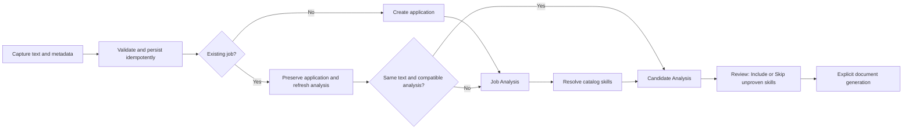

# Batch Job Intake API and Automated Analysis Plan

Updated: 2026-10-16. Implemented; see [job-intake-api.md](job-intake-api.md) for operational instructions.
Companion: [chrome-extension-plan.md](chrome-extension-plan.md).
The published OpenAPI document and fixtures define the shared v1 wire contract.

## 1. Scope and workflow

The extension captures already-open pages. The app owns validation, persistence, identity, analysis, and career facts.



- Automatically proceed through Candidate Analysis without requiring catalog approval or manual direction confirmation.
- Resolve known skill keys, names, aliases, and merge redirects deterministically. Unknown terms may create pending catalog skills, never personal career facts or automatic approvals.
- Aggregate Review by canonical skill ID while retaining all requirement sources.
- Catalog approval does not prove personal ability. Automatic use requires a matching personal Career Data skill and sufficient verified evidence.
- Direct matches are used automatically, without an exclusion control.
- Transferable matches require Include/Skip; a reason is optional, and document usage is qualified and Skills-only.
- Unknown-evidence matches require a reason for Include. Related technologies alone, such as React and Vue, do not prove possession.
- Default Review to "Only skills requiring a decision"; provide new-tab Manage skill links for edit, approve, and merge.
- Include applies only to this application. It does not approve catalog skills or update career facts.
- Never automatically generate documents, upload to Drive, submit applications, or merge cross-site jobs by company/title similarity.

## 2. Implementation boundaries

Recheck current schema and migration numbering. Do not restore obsolete tables or write to derived requirement-to-skill views.
Reuse existing Career Data, analysis, document, and queue services.
Preserve manual entry, HTML import, HTMX 422 fragments, Workspace, and Drive workflows.
The text intake API must not fetch arbitrary submitted URLs.

## 3. API v1 contract

Business dates use valid YYYY-MM-DD values; timestamps use timezone-aware ISO 8601.
Return JSON, never login redirects, HTML, or Basic Auth browser challenges.

### Authentication and capabilities

Require a high-entropy JOB_INTAKE_API_TOKEN through Authorization: Bearer.
Fail closed when missing, compare safely, and never log or return secrets. Rotation revokes the old token.
Replace website Basic Auth/CSRF only on explicitly supported intake paths, not all /api paths.
Only the extension service worker uses credentials. CORS and extension IDs are not authentication.
Use HTTPS in production; local HTTP exceptions are limited to localhost/127.0.0.1.
If needed, CORS uses explicit origins and headers.

GET /api/v1/job-intake/capabilities returns schema version, authentication status, limits,
polling interval, and repeatImportBehavior without exposing private data or model keys.

### POST /api/v1/job-intake/batches

Require Idempotency-Key. Generate a UUID for a new explicit submission; retain it for all HTTP retries.

```json
{
  "schemaVersion": 1,
  "clientBatchId": "fd7076ac-9f8e-4c54-b686-e902b85f7d6e",
  "items": [{
    "clientItemId": "fd7076ac-9f8e-4c54-b686-e902b85f7d6f",
    "sourceUrl": "https://jobs.example.com/view?jobId=123&utm_source=mail",
    "applicationSource": "Example Jobs",
    "rawText": "Complete job description with preserved paragraphs.",
    "suggestedMetadata": {
      "jobTitle": "Frontend Developer",
      "companyName": "Example Company",
      "location": "Vancouver, BC",
      "postedDate": null,
      "salary": "$90,000-$110,000 CAD"
    },
    "capture": {
      "capturedAt": "2026-10-16T10:00:00Z",
      "ruleId": "example-detail",
      "ruleVersion": "1",
      "fieldSources": {"jobTitle": "json-ld", "companyName": "css-selector"}
    },
    "identity": {
      "providerJobId": "123",
      "policy": {
        "version": 1,
        "queryMode": "keep-listed",
        "queryParams": ["jobId"],
        "dropQueryParams": ["utm_source"],
        "fragmentMode": "drop"
      }
    }
  }]
}
```

| Field | Limit / semantics |
| --- | --- |
| items | 1-20; request at most 4 MiB |
| clientBatchId / clientItemId | UUIDs; distinct item IDs within a batch |
| sourceUrl | Required HTTP(S), at most 2048 characters, no credentials |
| rawText | Required nonempty text, at most 60,000 characters and 128 KiB UTF-8 |
| applicationSource | Optional free text, at most 150 characters |
| jobTitle / companyName / location | Optional, at most 200 characters each |
| postedDate | Optional/nullable real date, not capture date |
| salary | Optional/nullable free text, at most 500 characters |
| capture | Bounded provenance; rule ID/version at most 120/100 characters |
| fieldSources | Known metadata keys; json-ld, css-selector, page-url, user |
| providerJobId | Optional, at most 200 characters |
| identity.policy | Bounded declaration; at most 30 query parameter names |

Normalize empty optional strings to null. Reject unknown fields and forged status, priority, IDs, or personal skills.
Treat captures/rules/URLs as untrusted. Invalid descriptions must not trigger model calls.

- Invalid envelopes, duplicate item IDs, and size violations return 400/413/422 without creating a batch.
- Invalid individual items are rejected with field errors while valid siblings continue. Do not retain oversized or malicious payloads in full.
- New submissions return 202. Same key and normalized payload return 200 with the original batch.
- Same key with changed payload returns 409. All-rejected batches return 422 with queryable results.
- Request idempotency and business identity are separate: new submissions may refresh existing applications.

Errors use {error:{code,message,fieldErrors?},requestId}, with stable actionable codes.
Use 401/403 for authentication, 404 for missing batch, 429 with Retry-After, and 503 for temporary unavailability.
Partial item failures are not server crashes. Acceptance is not analysis completion.

### GET /api/v1/job-intake/batches/:id

Return batchId, revision, isTerminal, status, counts, per-item progress/errors, exact child run IDs, and safe relative links.

- Item states: accepted, queued, processing, completed, duplicate, failed, rejected.
- Stages: intake, job-analysis, skill-resolution, candidate-analysis, done.
- completed means Candidate Analysis finished, not documents or human review.
- duplicate remains a legacy terminal state; new repeat imports track refreshed analysis.
- Batch states: processing, completed, completed-with-errors.
- Pending decisions and metadata conflicts do not prevent terminal completion.
- Never substitute an unrelated latest application run for this item's child run.
- Exclusive item counts sum to total; decisionCount is separate.
- Persist terminalRevision for notification deduplication. Later manual reruns do not reopen the import event.
- Missing onboarding/direction produces actionable failure, not invented analysis.
- Distinguish retryable errors, rate-limit waits, and final failures.
- Relative links must stay on the app origin and allowed paths.
- ETag/304 may be added; real-time push is unnecessary.

## 4. Identity and repeat-import semantics

Preserve sourceUrl independently of canonical identity.
Prefer server-validated website namespace plus provider job ID; otherwise recompute canonical URL from policy.
keep-all and fragment keep are defaults. keep-listed/drop require explicit configuration.
Preserve required/repeated query values and hash routes; reject overlapping retain/drop rules.
Do not silently alter host, protocol, path case, or slash semantics.
Rule version is provenance, not identity. Check provider ID, known aliases, and original URL across rule changes.
Backfill only safe identities; include Archived/Rejected applications. Unique indexes/transactions resolve races.
Do not merge cross-site reposts by title/company. Missing URLs are invalid.

For existing identities, preserve metadata/manual clears, status, contacts, activity, decisions, and artifacts.
Unchanged text reuses compatible Job Analysis and reruns Candidate Analysis against current career data.
Changed text appends an immutable posting version and runs both stages.
Equivalent in-flight work may be reused. Never attach results to a superseded source version.
Do not reuse completed Candidate Analysis for a new explicit refresh; HTTP retries remain idempotent.
Reuse Include/Skip only when canonical skill, requirements, personal evidence, and review policy fingerprints match.
Historical snapshots without trustworthy fingerprints fail closed. Keep old artifacts while marking stale dependencies.

## 5. Field adoption and provenance

For initial adoption: explicit user value/clear > protected existing value > valid capture > valid AI > unknown.
Store adopted source, confirmation, revision, suggestions, and conflicts, not a table per field.
DOM/JSON-LD priority is configured by the extension.

AI null never clears adopted data; user-cleared fields stay cleared.
AI may suggest title, location, postedDate, salary, and a configured direction, not company/URL/source.
Missing company uses a traceable imported placeholder, not a recruiting-site hostname as employer.
Unknown postedDate remains null through forms, sorting, import/export, and display.
Protect legacy fields without provenance conservatively.
Freeze revisions before model calls; stale results cannot overwrite concurrent edits.
Keep network calls outside SQLite transactions; assemble Candidate snapshots after safe metadata adoption.

## 6. Skills, Review, and merges

Resolve normalized terms/aliases/redirects with uniqueness constraints; split combined JavaScript/TypeScript terms.
Do not overwrite approved categories, invent taxonomy keys, or turn every source phrase into an alias.
Rejected/ambiguous terms must not be silently resurrected, duplicated, or approved.
Catalog issues must not reintroduce manual gating before Candidate Analysis.

Review refresh is DB-only and preserves tab/filter/scroll and unsaved reasons.
On focus, detect relevant changes rather than blindly replacing local inputs.
Pending catalog status does not itself block documents or prove ability.

For user-confirmed synonym merges:
- Preserve source redirects and move aliases without stealing third-party names.
- Audit all current references, including mentions, career skills, project/achievement skills, and decisions.
- Never silently upgrade personal levels, eligibility, or evidence.
- Prefer explicit decisions over pending, combine compatible reasons, and reconfirm Include/Skip conflicts.
- Preserve historical AI snapshots and project identities through redirects.
- Invalidate unsafe fingerprints; do not reuse decisions after material evidence/identity changes.
- Display-only edits must not fabricate evidence or automatically invoke a model.
- Genuine JD/evidence/decision changes update consumer freshness; regeneration is not reanalysis.

## 7. Durable queues and provider concurrency

Reuse bunqueue embedded mode and the existing queue database, not Redis or another queue system.
Persist batches/items before replying. jobs.db and queue storage cannot share one transaction:
use durable dispatch/outbox state and startup/periodic recovery.
Persist stable job IDs, exact child runs, stages, claims, retries, and dispatch state.
Retry unfinished stages without paying again for completed compatible work.
Recover interrupted chains instead of leaving processing forever.

Default total in-flight provider calls to 3 with OPENAI_MAX_CONCURRENT_REQUESTS.
All workers, local fallbacks, parsing, generation, and review share this per-process budget.
Multi-process deployments require explicit budget allocation; this is not cluster-wide rate limiting.
Concurrency differs from RPM/TPM: honor Retry-After, bounded backoff/jitter, and nonretryable quota errors.
Assign retry ownership once to avoid multiplicative retries.
Use short completion transactions and claims/CAS; never hold DB transactions across provider calls.
Record model/reasoning parameters and usage; do not hide latency by silently changing models.
Preserve manual URL import without refetching extension-provided text.

## 8. Persistence and delivery sequence

Forward migrations only; update schema, health, import/export, and tests.
Preserve career facts, OAuth, applications, history, artifacts, and persistent DB paths.

| Stage | Delivery | Acceptance |
| --- | --- | --- |
| A | Contracts, OpenAPI, fixtures | Shared payload/error/state definitions |
| B | Batch/item/source identity/provenance persistence | Fresh/populated migrations, FK/unique, rollback |
| C | Token-auth API routes | JSON errors, limits, replay/conflict, website auth regression |
| D | Durable dispatch and provider limiter | Recovery, bounded concurrency, stage reuse |
| E | Pending resolution and evidence-backed Review | No career-fact pollution |
| F | Metadata adoption and source versions | Preserve edits; refresh repeat imports safely |
| G | Merge projection and Review UI | Consistent references, reasons, partial boundaries |
| H | Batch UX and operations docs | Candidate completion and integration verification |

Keep stages runnable; avoid speculative event/token/notification platforms.

## 9. Verification and handoff

Use bun:test, synthetic captures, mocked providers, and temporary SQLite/queue databases.
Cover auth/CSRF isolation; sizes/dates/URLs; salary 500/501 boundaries; mixed/all-rejected batches;
replay/409; provider URL variants; query/hash policies; rule changes; concurrent/archived identity;
AI/capture conflicts and user clears; crash recovery; throttling; skill aliases/merge conflicts;
personal evidence, reason rules, safe decision reuse; stable workspace-shell/workspace-tabs/skill-review-panel/OOB and 422 fragments.
Completion notification waits for Candidate Analysis, not human decisions; terminalRevision stays stable.
Run formatting, typecheck, full tests, build, and git diff --check.
Never spend live model credits or deploy production in automated tests.

Copy versioned OpenAPI and synthetic fixtures to the extension, not backend implementation.
End-to-end target: group capture -> batch -> Candidate completion -> one notification -> Review -> explicit documents.

References:
- [bunqueue](https://github.com/egeominotti/bunqueue)
- [OpenAI rate limits](https://developers.openai.com/api/docs/guides/rate-limits)
- Chrome references in the companion extension plan.
