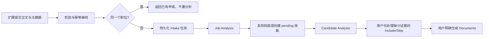

# 批量职位接收 API 与自动分析实施计划

日期：2026-10-16。状态：已实施；接入和运行说明见 [job-intake-api.md](job-intake-api.md)。

配套扩展计划：[chrome-extension-plan.md](chrome-extension-plan.md)。
本文件的 API v1 契约是两个仓库的共同依据；扩展仓库应复制固定版本的
OpenAPI/fixtures，而非自行重新定义字段或状态。实现时产出正式 OpenAPI 文档。

## 1. 目标和已经确认的产品规则

扩展在另一个仓库采集页面，本仓库负责接收、去重、持久化和分析。



- 没有人工映射/approve/确认 direction 的前置步骤；自动运行到 Candidate Analysis。
- 未知技能允许自动创建 pending，不自动 approved，不添加到个人 career skills。
- 标准技能相同则复用；同一 skill 在 Review 合并展示，保留所有 requirement 来源。
- 只要求未找到充分证据的技能做 Include/Skip；Include 必须附理由。
- 已验证有证据的技能默认使用，不增加排除功能。
- Review 默认勾选 Only skills requiring a decision；允许查看全部证据。
- Pending skill 可从 Review 新标签页进入编辑、approve、merge 页面。
- 页面元数据冲突自动采用规则，不能中断自动分析。
- 同职位再次导入直接忽略，即使正文变化；返回原申请链接，不自动建版本。
- 不同网站转载同一职位不自动合并。无 URL 不属于扩展入口，直接校验失败。
- 自动生成 Documents 不在本轮范围；不改写职业事实、不自动申请。

## 2. 实现前必须复核的当前代码

当前仓库经历过 schema 简化，不沿用早期 51-table 方案：

- `src/db/schema.ts`、`drizzle/`：当前迁移到 0030；实现时重新检查最新编号。
- `job_requirements_to_skills` 已经是从 mentions 派生的只读 view，不能往里面写。
- generation/baseline 已整合；不恢复旧表，career 状态也应复用当前设计。
- `src/db/job-intake.ts`、`src/lib/job-intake/{queue,batch,import}.ts`：
  当前 intake 是进程内顺序处理，不是持久化 bunqueue intake worker。
- `src/lib/job-analysis/queue.ts`：当前 concurrency 为 1，pending mention 阻塞 auto-chain。
- `src/lib/analysis/{chain,queue}.ts`、`src/lib/candidate/analysis.ts`、
  `src/lib/applications/readiness.ts`：去掉目录审核作为分析/生成前置条件。
- `src/db/job-analysis-runs.ts`：非空 AI 字段会覆盖 application，必须改为来源感知更新。
- `src/db/{skill-mentions,skill-mapping-service,skill-service,analysis-decisions}.ts`：
  检查 approved-only 限制、merge 的新表引用覆盖和决定唯一性。
- `app/routes/_middleware.ts` 当前全站 Basic Auth + CSRF；API 使用独立认证分支。
- 原 HTML 导入页、HTMX 422、Workspace、Drive 和现有手动录入必须继续正常工作。

## 3. API v1 契约

所有时间戳使用带时区的 ISO 8601 字符串；业务 postedDate 为真实 YYYY-MM-DD。
错误响应为 JSON，API 不重定向登录、不返回 HTML、不返回 WWW-Authenticate 弹窗。

### 3.1 认证和部署

- 专用 `JOB_INTAKE_API_TOKEN` 环境变量：高熵随机值，服务端定时比较，缺失时 API
  fail closed；只授权下述 intake/身份查询端点，不授予 career/export/Drive 等权限。
- 扩展使用 `Authorization: Bearer ...`。第一版单用户无需建立通用账号/token 平台；
  替换此 secret 即撤销旧凭证。日志、响应和错误消息不包含 token。
- Basic Auth/CSRF 仅在明确列举的 API 路径上替换为 token 校验；保留网站原有保护。
  不对整个 /api 做匿名豁免，不依赖 CORS 或 extension ID 作为认证。
- 扩展 service worker 请求；不允许网页 content script 直接带 token 调用。
  如需 CORS，配置明确来源和必要 headers，不能反射任意 Origin。
- 生产 HTTPS；本地允许 localhost/127.0.0.1 明确配置，例外不扩展到任意 HTTP 主机。
- `GET /api/v1/job-intake/capabilities` 返回契约版本、限额和认证有效性，供测试连接；
  不泄漏账号资料、环境变量或模型密钥。

### 3.2 POST /api/v1/job-intake/batches

必需 `Idempotency-Key`（每次用户明确提交生成 UUID，同一次网络重试保持不变）。

```json
{
  "schemaVersion": 1,
  "clientBatchId": "a-uuid",
  "items": [
    {
      "clientItemId": "another-uuid",
      "sourceUrl": "https://jobs.example.com/view?jobId=123&utm_source=mail",
      "applicationSource": "Example Jobs",
      "rawText": "完整且保留段落的职位正文",
      "suggestedMetadata": {
        "jobTitle": "Frontend Developer",
        "companyName": "Example Company",
        "location": "Vancouver, BC",
        "postedDate": null,
        "salary": "$90,000–$110,000 CAD"
      },
      "capture": {
        "capturedAt": "2026-10-16T10:00:00Z",
        "ruleId": "example-detail",
        "ruleVersion": "1",
        "fieldSources": {
          "jobTitle": "json-ld",
          "companyName": "css-selector"
        }
      },
      "identity": {
        "providerJobId": "123",
        "policy": {
          "version": 1,
          "queryMode": "keep-listed",
          "queryParams": ["jobId"],
          "dropQueryParams": ["utm_source"],
          "fragmentMode": "drop"
        }
      }
    }
  ]
}
```

字段和边界：

| 字段 | 契约 | 对应存储/用途 |
| --- | --- | --- |
| items | 1–20，整体请求最多 4 MiB | 批量接收上限，不是 OpenAI 并发数 |
| clientBatchId / clientItemId | UUID；批内 item ID 不重复 | 网络重试幂等 |
| sourceUrl | 必需，HTTP/HTTPS，最长 2048，无 URL 用户信息 | 原始 URL/application.url |
| rawText | 必需，非空，最多 60,000 字符且 UTF-8 不超过 128 KiB | job_postings.raw_text |
| applicationSource | 可选，最多 150 | 自由文本，不建枚举 |
| jobTitle/companyName/location | 可选，每项最多 200 | 采集建议，不是用户已确认事实 |
| postedDate | 可选/nullable，校验日历有效性 | 不把捕获日期伪装为发布日期 |
| salary | 可选/nullable，最多 150，自由文本 | 保留币种、周期和原文 |
| capture | 可选，有界字段，ruleId/version 最多 120/100 | 溯源，不参与事实可信度提升 |
| fieldSources | 仅上表元数据 key；值为 json-ld/css-selector/page-url/user | 字段来源 |
| providerJobId | 可选，最多 200，不含凭证 | 网站内职位身份 |
| identity.policy | 可选、声明式、有界；query 参数最多 30 个 | 去重规则，绝不执行客户端代码 |

空可选字段规范成 null；拒绝未定义字段、forged status/companyId/priority/skill 等。
捕获元数据、规则和 URL 均为不可信输入；服务器不 fetch 扩展提交的 URL。
无正文/网页错误正文不触发 OpenAI；完整性不足应在扩展先提示。
本计划的能力 API 返回上述限制，扩展同时执行本地校验。

入队接收分两个层次：

- 包装格式错误、重复 clientItemId、超限：400/413/422，不创建批次。
- 合法 envelope 内单项错误：记录该 item 为 rejected，其他有效项继续。
  返回 rejected 的 fieldErrors；不保存恶意或超长载荷全文。
- 新批次返回 202；相同幂等 key + 相同规范化载荷返回 200 和原批次。
  相同 key + 不同载荷返回 409，不能创建第二批。全无效批次返回 422，仍带
  可查询的批次/item 结果；文档和实现需固定这个语义。
- clientItemId 在同一 clientBatchId 内唯一，批内序号保留。
- 业务去重与请求幂等分开；不同批次重复职位仍产生可追踪 duplicate item。

响应骨架：

```json
{
  "schemaVersion": 1,
  "batchId": 42,
  "status": "processing",
  "revision": 1,
  "isTerminal": false,
  "statusUrl": "/api/v1/job-intake/batches/42",
  "reviewUrl": "/applications/import?batchId=42",
  "items": [
    {"clientItemId": "another-uuid", "itemId": 81, "status": "accepted"}
  ]
}
```

错误统一 `{error:{code,message,fieldErrors?},requestId}`；稳定 code 供扩展使用。
401/403 为认证/权限，404 批次不存在，429 接收限速含 Retry-After，503 暂时不可用。
部分失败不是 HTTP 500；HTTP 接收成功不等于分析成功。

### 3.3 GET /api/v1/job-intake/batches/:id

JSON 返回批次 revision/isTerminal/status、counts、每项状态及链接：

- item status: accepted, queued, processing, completed, duplicate, failed, rejected。
- stage: intake, job-analysis, skill-resolution, candidate-analysis, done。
- completed 只表示 Candidate Analysis 已完成；不是 intake ready 或文档生成。
- duplicate/rejected/failed/completed 都是本次批次的终态。
- duplicate 链接已有 application，不等待或重启已有申请分析。
- completed 可有 decisionCount > 0、metadataConflictCount > 0，不影响终态。
- 保存明确关联的 job/candidate run ID，不能把“该申请最新 run”误当本次完成。
- counts 的互斥 item 状态之和等于 total；decisionCount 是另一个独立计数。
- batch status: processing（任一非终态）、completed（全完成/重复且无失败）、
  completed-with-errors（全部终态但有失败/rejected）。不等用户 Include/Skip。
- terminalRevision：首次进入终态生成稳定事件标识，用于跨重启通知去重。
  同一批次后续人工重分析不再次触发初次导入完成通知。
- progress/error/retryable 字段明确区分等待限流、基础数据未配置、最终失败。
  缺 career onboarding/direction 时项目 fail with actionable code，不凭空分析。
- 返回 reviewUrl/applicationUrl 相对路径，只能指向当前 app，防开放跳转。
- 可支持 If-None-Match/ETag 返回 304；不要求第一版实时推送。

## 4. URL 身份、重复忽略和配置变更

原始 sourceUrl 始终完整保留，去重 identity 单独存储：

1. 有 providerJobId：由服务器从 URL 校验并确定网站 namespace，使用
   `namespace + providerJobId`。namespace 不接受客户端任意指定；必要时在规则
   中声明 canonical host，服务端只允许同站点或已配置的可信 host alias。
2. 无 providerJobId：服务器按声明 policy 重算 canonical URL；不能信任客户端 hash。
3. queryMode 为 keep-all 或 keep-listed；缺省 keep-all，仅删除显式已知跟踪项。
   queryParams 为保留清单，dropQueryParams 为删除清单，冲突配置拒绝。
   重复 query 值不丢失；不要对任意站点盲目排序会改变含义的重复参数。
4. fragmentMode 为 keep/drop，缺省 keep（兼容 hash routing）；可按网站明确 drop。
   不擅自更改路径大小写、尾部斜杠、HTTP/HTTPS 或 www 等主机身份。
5. 规则变更不能成为简单 identity hash 的一部分，否则重复全部漏检；记录 policy
   和版本，同时查 provider ID、已知 canonical aliases 和精确原始 URL。
   同一原始 URL 更改规则时补充 alias，不创建第二申请。URL/规则全变且无稳定 ID
   时存在无法自动判断的边界，明确记录，不用公司/标题模糊合并。
6. 旧申请在迁移时只回填能确定的原始/已知身份；碰撞列为已存在的重复，不删历史。
   所有状态包括 Archived/Rejected 都参与去重。
7. 唯一索引＋事务解决两个并发请求争抢同一职位。失败重试可恢复原 intake 工作，
   不能创建新申请；新的重复导入本身不自动触发旧失败任务重跑。

不需要另加独立去重服务。可新增一张 job_source_identities（多个唯一 identity
alias -> 一个 application），字段索引支持直接定位；无外部回调/任意 URL fetch。

## 5. 字段自动采用及用户值保护

保存 capture 原始载荷和字段来源。建议在 job_applications 增加有版本的
field_provenance_json：当前采用来源、userConfirmed、字段 revision；采集/AI
候选值和冲突关联 intake/run 保留。不要添加一张表给每个字段。

优先级：用户明确值（含清空） > 已有用户确认值 > 本次有效页面值 > AI 有效值 > 未知。
DOM 和 JSON-LD 的优先级由扩展规则决定；服务器仍保留对应 provenance。

- AI 空值不清空已采用值；用户清空是明确决定，不被后续自动补回。
- 新记录页面/AI 冲突保留页面值，记录冲突，不强制用户处理。
- AI 只补 jobTitle/location/postedDate/salary，direction 从数据库的有效方向建议。
  Company、URL、source 不交给模型决定。缺公司可以留明确的 Imported 占位实体，
  不把招聘网站域名当作真实雇主；占位来源可追踪，用户以后修正。
- direction 没有采集字段；优先用户确认值，否则采用有效模型建议。无有效方向
  是可诊断配置失败，不硬编码 fullstack。
- posted_date 当前 NOT NULL；前向迁移为 nullable，更新全部表单/排序/提示/导出/
  版本化导入，未知日期显示 Unknown，不用今天制造事实。created/captured 日期独立。
- 相对日期若扩展不能准确确定，传 null；可在溯源中保留 datePosted 原文字串。
- 给队列输入冻结字段 revision；等待期间用户修改后，旧 AI 不覆盖新值。字段合并
  事务短小，模型网络调用绝不放在 SQLite transaction 中。
- 已有 provenance 缺失的旧值保守视为需保护，不当作可随意覆盖的占位值。
- 元数据采用后再构建 Candidate Analysis 快照；正在运行的结果不能挪到错误版本。

## 6. Pending skills、Review 和同义合并

### 自动解析

已知 key/名称/aliases 确定性复用，沿 merge redirect 解析；未知规范化 term
创建 `origin=job-parser, review_status=pending`。数据库唯一约束＋冲突后重读解决
并发创建，不靠 prompt 去重。反转的 JavaScript/TypeScript 组合拆成两项；不同
requirement 保留，Review 以 skill ID 汇总。pending 可有已有 category key 建议，
不能创建陌生类别；已审核类别不被新分析覆盖，不自动把原文全部变成 alias。

Rejected/ambiguous 历史记录不自动复活/approve/强行 merge；保留来源与审核状态，
允许本次 requirement 继续评估。实现要让这些异常 term 同样可做决定，不能再次
引入人工作为 candidate 的前置门槛；不要制造第二个冲突名称来绕开 rejection。

Catalog 审核状态与 evidenceStatus 分离：pending 也能有合法职业证据，approved
也可能没有个人证据。只有真实有效证据决定自动使用，不按目录状态推断能力。
输出仍按 requirement 评估 direct/transferable/unknown-evidence，校验 source IDs。
Remove pending-mention guard from chain/readiness/decision/generation query paths
as a coherent change; retain personal career facts的安全与真实性约束。

### 用户唯一必要操作

Review 默认 checkbox 为 Only skills requiring a decision。已确认有证据自动使用，
不提供其排除按钮；取消过滤可看全部证据。未证实技能 Include（必填理由）或 Skip。
当前操作已决定行暂留并显示结果，待决定计数即时减少；重新加载按过滤隐藏。
每行显示 Pending/Approved 和 Manage skill 链接，新标签页保持 Review 上下文。
Include 不 approve、不创建个人 skill；pending 本身不阻止 Documents。

Review 提供 Refresh 图标：只重新读取 DB，无模型调用；保留 Tab、过滤和滚动，
不能丢失尚未提交的理由输入。窗口重新获得焦点时先比较相关 revision；有本地
未保存输入则提示刷新/保留，不盲目换掉 textarea。

### Merge 的一致性

- 只对用户认定同义概念做 merge，不自动融合不同能力。
- 保留原 skill 标记 merged/redirect；原名称/aliases 归 target，旧 key 通过 redirect
  继续解析。遇到第三方占用拒绝并显示冲突，不抢占 alias。
- 用当前 FK 清单审计 mentions、career_skills、achievement/project skills、decisions
  等，事务性迁移/去重；不能只处理原来几张 operational 表。
- 两条个人 skill 的 level/eligibility/evidence 不静默提升，合并预览收集所需选择。
- 一方有决定另一方 pending：保留决定；两条 Skip 合并；两条 Include 保留所有
  理由和来源；Include/Skip 冲突标记需用户再次决定，不触发 AI。
- 历史 AI 快照不改写。新增只读 canonical projection 把历史 skill 映射到当前
  redirect；必要时保留 run-scoped decision provenance，不能伪造新模型结果。
- 普通 rename/category/approve/同义 merge 不使 candidate 因显示身份变化而 stale；
  用分离的事实/目录/编辑 revision/hash 防止当前散列机制误报。真实证据、JD 或
  用户决定变化仍按消费者依赖更新 freshness；需要重新生成文档不等于重新分析。
- 不因 merge 重新请求 OpenAI。若后来改变了技能的实际含义，应提示用户明确重分析，
  不包装成普通 synonym merge。

## 7. 持久化队列、并发与可靠性

复用 bunqueue/client 嵌入式模式和现有同一个队列 DB，不引入 Redis/第二种队列。
一个 intake item 一个任务，后续分别衔接 Job Analysis/Candidate Analysis。

- 接收事务保存 batch/items/身份声明，先持久化再回复。jobs.db 和 bunqueue DB
  不能共享一个 SQLite 事务：使用 DB 待派发状态作 outbox，提交后 durable add，
  启动/周期恢复补投递；入队失败不丢掉 accepted item。
- 稳定 jobId 只是队列去重，业务唯一索引/事务仍必须提供幂等。重试只续处理未完成
  的 stage，保存 child run IDs，不能重复付费分析已经完成的阶段。
- 当前 auto-chain 捕获错误仅写日志；改为可恢复的 persisted next-stage dispatch，
  批次不能永远卡在 processing。超时/worker 死亡/孤儿任务有恢复或终态机制。
- 默认 OpenAI 全阶段总在途上限 3，Job Analysis/Candidate Analysis worker 可各
  并发最多 3，但共同经过一个共享限额。其它生成/审核/单条解析同样计入总量。
  本地 in-process fallback 也走同一 limiter，不能无限 void process 绕开限制。
- 配置 `OPENAI_MAX_CONCURRENT_REQUESTS=3`，限于已存在的单进程部署；多个进程/
  机器时必须按部署分配预算或使用共享限流，不能宣称进程级限制是集群限制。
- 并发不是 RPM/TPM 限制；记录 token/延迟/429，遵从 Retry-After，指数退避＋jitter，
  有限重试。余额/配额耗尽不重试；只在队列或调用层选一个重试负责人，防乘法重试。
- 等待 provider 在 DB 事务外；完成时短事务写入。相同源的并发处理须有 claim/CAS。
- 不改现有 reasoning/model 默认值来掩盖速度问题；记录采用参数，支持可比较测试。
- 保留现有手动 URL 导入抓取路径，扩展传正文的路径不重复抓网页。

## 8. Schema 变更清单

只新增必要结构，具体列名依已有类型规范：

1. batch：clientBatchId/idempotency key/request hash、相关 revision/终态事件标识。
2. item：clientItemId、capture/identity policy/source payload、pipeline stage/status、
   child run IDs、重试/claim/待派发信息。避免 old ready 与新 completed 混用。
3. job_source_identities：全局唯一身份 alias -> application，兼容 policy 变更。
4. application：nullable postedDate、field provenance/confirmed flags。
5. 必要的决定来源记录支持 merge 后保留多理由；优先复用现有 JSON 字段/规范化关联。
   不无理由引入完整事件平台/通知服务器/token 管理平台。

所有变更前向 migration，更新 schema/health/import/export/tests。不改已应用 SQL，
不删除 career facts、OAuth、原申请/历史文档。队列 DB 仍是原路径，勿部署新临时 DB。

## 9. 分阶段实施与 commits

| 阶段 | 主要文件/交付 | 验收重点 | 建议 commit |
| --- | --- | --- | --- |
| A | src/lib/job-intake/contracts.ts、OpenAPI、合成 fixture、契约测试 | 当前两文档的载荷/错误/状态完全一致 | test: define extension intake API contracts |
| B | schema.ts、前向 drizzle、job-intake DB/identity/provenance 服务 | fresh/populated 迁移、unique/FK、日期未知、重复请求回滚 | feat: persist intake identity and field provenance |
| C | API routes、auth 分支、capabilities、接收/状态服务 | JSON 认证、限额、幂等、部分错误、原网页安全回归 | feat: accept authenticated job intake batches |
| D | intake queue、job/candidate chain、共享 provider limiter、恢复 | 跨 DB crash windows、并发最大 3、阶段复用、最终错误 | feat: process intake through bounded durable analysis queues |
| E | prompts/schema、mentions/skills/decision/readiness | pending 自动创建并分析到结束、无个人事实污染 | feat: automate pending skill resolution and candidate review |
| F | metadata merge、所有手动表单写入、analysis 完成事务 | 采集优先、用户值和清空保护、冲突不阻塞、重分析不覆盖 | fix: preserve sourced and user-confirmed application fields |
| G | skill merge 服务、Review components/routes、focus 检查 | 全部 FK、alias、理由冲突、无 AI 刷新、无排除已证实技能 | feat: refresh skill review after catalog edits and merges |
| H | batch UI/status、API fixtures/docs、env example、README | terminal 语义、重复链接、扩展模拟 end-to-end、操作文档 | docs: publish extension intake contract and operations guide |

顺序允许 D/E/F 以小的内部兼容层衔接，但不得把新接口对外宣称完成而主流程仍阻塞。
每阶段有可运行检查；新行为与断言同步交付，不提交伪绿 TODO/skip。

## 10. 测试与验收

- bun:test；mock OpenAI/fetch，显式临时 SQLite/queue DB；不接触真实用户 DB/凭证。
- 表单/metadata：并发用户编辑、显式清空、AI null/冲突、缺公司/日期/方向、旧 provenance。
- API：401/JSON、不绕过网页 auth/CSRF、body limits、逐项 errors、key 重放/冲突。
- 去重：LinkedIn/Indeed URL 变体、保留 query/hash route、同原始 URL 换 policy、
  Archived/Rejected、两个同 URL 同时提交、旧申请回填、不同网站不模糊合并。
- 队列：接收后 crash、队列不可用后恢复、child 已完成不重付费、candidate enqueue
  失败恢复、429/backoff/预算耗尽、local/prod 共享并发上限。
- skills：同 term 同时创建、组合拆分、approved/category 不覆盖、merge redirect、
  所有 FK/重复决定/两条 Include 理由、普通 merge 不触发模型/分析 stale。
- Review：默认过滤/计数、已证实无排除、Include 理由、pending 管理链接、刷新输入保护、
  stable workspace-shell/workspace-tabs/skill-review-panel/OOB，422 不替换整个页面。
- 批次：Candidate 完成前不通知完成；待人工 Include 不阻塞终态；混合失败/重复
  terminalRevision 稳定，用户后来 rerun 不误归本批次。
- 完成后运行 format:check、typecheck、bun test、build、git diff --check。
  生产部署、真实 API 调用和 secret 配置由后续明确操作执行，本计划不部署。

## 11. 与扩展仓库的交付边界

后端先冻结 API v1 schema/identity 规范/fixture，提供认证与状态模拟数据；扩展
可先按 fixture 开发。联调使用本地合成职位，不自动抓真实账户页面或花模型费用。
扩展负责配置、采集、提交、轮询和通知；app 不需要浏览器 Web Push 订阅表。
正式联调验收：同组 10 条 -> 一次提交 -> 自动完成 candidate -> 一次通知 -> Review。

参考（计划阶段已通过 Context7 核对，实施前按已安装版本再确认）：

- [bunqueue embedded workers](https://github.com/egeominotti/bunqueue)：durable add、jobId、concurrency。
- [OpenAI rate limits](https://developers.openai.com/api/docs/guides/rate-limits)。
- Chrome API/权限细节见配套扩展计划。
